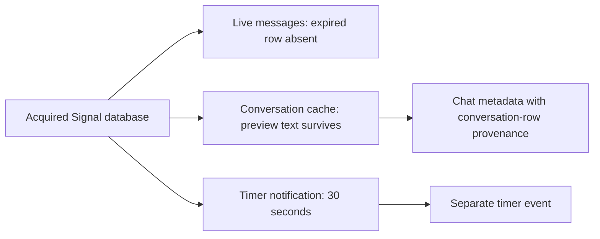

# exhume_artefacts

The `exhume_artefacts` documentation is maintained at [forensicxlab.com](https://www.forensicxlab.com/docs/exhume_artefacts/getting-started).

## Public API and CLI builds

Parser imports use `parsers::android`, `parsers::ios` and `parsers::windows`.
SQLCipher helpers use `formats::sqlite::sqlcipher`. The former `parsers::mobile`,
top-level Windows module aliases and root `sqlcipher` alias have been removed.
Parser registry identifiers are unchanged.

Distributed CLI binaries include SQLCipher. Library consumers opt in with the
`sqlcipher` feature. Native Windows release builds use
`sqlcipher-vendored-openssl`, which includes SQLCipher and statically bundles its
OpenSSL provider; macOS release builds retain CommonCrypto. Extracted release
binaries are smoke-tested by decrypting and parsing an encrypted Signal fixture.

## Offline macOS Keychain recovery

`formats::keychain::LegacyKeychain` decodes file-based `kych` Keychains and
authenticates database keys with an exact password. Its unlocked handle can
recover one generic-password candidate by exact service and account, with file
offsets for the item and wrapping-key record. Secrets are erased on drop,
redacted in Debug and never serialized. See the module's library example and
the native synthetic fixture in `src/formats/keychain/fixtures/`.

Some login Keychains protect the database with an indirect password rather than
the session password itself. `protected_entropy_identifier()` supplies the
salt-derived filename to find under `/private/var/db/SystemKeys/` in the evidence.
Decode that plist's 32-byte CFData value and pass it, together with the exact
session password, to `unlock_login_password()`. It derives
`HMAC-SHA256(protected_entropy, password)` before the ordinary Keychain KDF and
full database/key-blob authentication. Both protection routes may use blob
version `0x200`; version alone cannot select one. A failed direct-password check
does not establish that the user's session password is wrong.

The registered `macos_keychain` parser still emits metadata. Its optional secret
option `password` checks the database protection blob before emitting records;
`recovery.status = database_keys_authenticated` describes that limited scope.
Without a password, it extracts metadata as before. Malformed password rows
produce `RecordParse` diagnostics carrying the record number and byte offset.
The parser bounds each primary/WAL/SHM input to 64 MiB.

The parser's optional secret setting `protected_entropy` accepts that CFData
value as exactly 64 hexadecimal characters, with `password`. Its recovery
metadata identifies `direct_password` or `login_password_protected_entropy`;
neither submitted nor derived secrets are emitted. Library callers can supply
the raw 32-byte value directly. Evidence discovery/provenance for the SystemKeys
companion belongs to the caller; the parser does not open analyst-system paths.

Database/key-blob authentication does not authenticate searchable attributes or
the individual `ssgp` password ciphertext. Recovered values require validation
by the consuming application. `formats::os_crypt::decrypt_macos_v10` decodes the
macOS Chromium/Electron `v10` envelope in `config.json` using the recovered Safe
Storage value. It returns a redacted `ParserSecret` candidate; it does not perform
plaintext fallback or treat CBC padding as authentication. Validate Signal's
64-character hexadecimal key with SQLCipher, then supply it to the existing
`desktop_signal` parser's `database_key` setting. The full indirect-Keychain →
macOS envelope → encrypted Signal parser chain has a synthetic regression test.
The indexer's optional `sqlcipher` feature now coordinates acquired-file
discovery, scoped credential requests and resumable Signal parsing.
SQLite `keychain-2.db`, SEP/keybag recovery and System Keychain unlock files are
not supported for decryption; SQLite metadata/WAL parsing remains available.

Apple's implementation of the login-Keychain route is in
[`SSDatabase.cpp`](https://github.com/apple-oss-distributions/Security/blob/db15acbe6a7f257a859ad9a3bb86097bfe0679d9/OSX/libsecurity_apple_cspdl/lib/SSDatabase.cpp)
and [`transition.cpp`](https://github.com/apple-oss-distributions/Security/blob/db15acbe6a7f257a859ad9a3bb86097bfe0679d9/securityd/src/transition.cpp).

## Signal key recovery helpers

`recovery::signal::SignalKeyEnvelope` decodes bounded `config.json` input and
distinguishes legacy plaintext keys, direct DPAPI blobs and `v10` envelopes.
An invalid `encryptedKey` never falls back to `key`. Returned keys are redacted,
zeroizing `ParserSecret` values containing exactly 64 ASCII hexadecimal bytes.

On Windows, `windows_master_key_guid()` identifies the required acquired DPAPI
master-key file. The `v10` route also consumes Signal's acquired `Local State`.
After the caller unlocks that master key, `recover_windows()` authenticates the
DPAPI blob and, for `v10`, the AES-GCM envelope. On macOS, `recover_macos()` uses
the exact Safe Storage value recovered from the Keychain. Its CBC result remains
a candidate until the consuming SQLCipher parser validates it.

These helpers do not discover files, prompt, access native credential stores or
persist secrets. The indexer owns those evidence relationships and attempts;
the existing `desktop_signal` parser owns database interpretation. DPAPI and
Keychain preflight methods identify unsupported protection before requesting a
password.

## Offline Linux Signal and secret-store recovery

Linux Signal profiles can contain a legacy plaintext `key` in `config.json`,
even while `sql/db.sqlite` is encrypted by SQLCipher. Signal retains that route
when Electron secure storage is unavailable. A protected profile instead stores
an `encryptedKey` and may record `safeStorageBackend`. Preserve the configuration,
database and WAL/SHM companions from the same installation. Beta, AppImage and
Flatpak packaging can change the profile directory and Secret Service application
attribute.

`formats::gnome_keyring::GnomeKeyring` parses binary GNOME collections with
version/protection bytes `0,0,0,0`. `unlock_password()` consumes exact password
bytes, derives a key and IV by iterating SHA-256 over password plus eight-byte
salt, and decrypts AES-128-CBC. The initial unkeyed MD5 covers the rest of the
decrypted payload, including its zero padding. This checksum detects wrong
passwords and damage without authenticating the collection or its outer index.
Wrong passwords and damaged ciphertext share a `ChecksumFailed` result.

The unlocked handle exposes item metadata. `recover_secret()` requires exact
decrypted text attributes and exactly one matching item. For Chromium/Electron's
libsecret route the selector uses `application`, whose value depends on the
package. Recovered bytes stay in a redacted, zeroizing handle with the outer
index location and decrypted record offset. Secrets are never serialized into
parser records. Collection timestamps are retained in file order because
GNOME's writer and reader disagree on their creation/modification ordering.
Error offsets describe the current buffer, which is the original file during
parsing and the decrypted payload during unlocking.

The registered `linux_gnome_keyring` parser emits collection and hashed item
metadata without a password. Its optional secret option `password` unlocks item
labels, timestamps and attributes. `recovery.status = payload_md5_verified`
describes the checksum scope. Structural errors abort parsing. An empty
collection still emits a collection record. Inputs, fields, item/attribute counts
and KDF iterations are bounded, and the library recovery methods accept a
cancellation flag.

`formats::os_crypt::decrypt_linux()` and
`recovery::signal::SignalKeyEnvelope::recover_linux()` support Linux `v11` and
legacy `v10`. Both use PBKDF2-HMAC-SHA1 with `saltysalt`, one iteration, AES-128-CBC
and an IV of sixteen spaces. `v11` consumes the exact recovered Safe Storage
value, including Base64-looking characters and whitespace. `v10` explicitly
selects Chromium's fixed `peanuts` password. A failed `v11` never selects `v10`
or a plaintext configuration key. The result must contain exactly 64 ASCII
hexadecimal characters, then pass SQLCipher/schema and parser reads. CBC padding
and a Keyring checksum alone do not establish database-key validity.

The standalone example accepts explicit acquired files, discovers database
companions through the existing input adapter, and streams parsed JSONL. It
passes the database key in memory. For a legacy configuration:

```sh
cargo run -p exhume_artefacts --features sqlcipher --example recover_signal_linux -- \
  --database /case/Signal/sql/db.sqlite --config /case/Signal/config.json
```

For a `v11` profile add the matching collection, exact password file and selectors:

```sh
cargo run -p exhume_artefacts --features sqlcipher --example recover_signal_linux -- \
  --database /case/Signal/sql/db.sqlite --config /case/Signal/config.json \
  --keyring /case/keyrings/login.keyring --password-file /case/keyring-password.bin \
  --attribute application=signal
```

Password files are bounded and have **no newline trimming**. Replace the example
application value with the one in the acquired collection. Select SQLCipher 3
explicitly using `--cipher-version 3` for older databases. The default is 4.

The GNOME decoder is verified against GNOME 48.0's untouched upstream fixture.
Dedicated Linux integration tests compare recovered encrypted Signal records
with a plaintext synthetic copy. Fixture generation uses independent Python
cryptography and SQLCipher. Modern KDE KWallet is supported as described below;
other Secret Service providers and GNOME's plaintext keyring format remain
unsupported. The indexer's `sqlcipher` feature coordinates profile discovery,
scoped credential requests and resumable Linux parsing through these helpers.

Upstream behavior is defined in Signal's
[`getSQLKey`](https://github.com/signalapp/Signal-Desktop/blob/v8.37.0-beta.1/app/main.main.ts),
GNOME's [`gkm-secret-binary.c`](https://github.com/GNOME/gnome-keyring/blob/48.0/pkcs11/secret-store/gkm-secret-binary.c)
and [`egg-symkey.c`](https://github.com/GNOME/gnome-keyring/blob/48.0/egg/egg-symkey.c),
and Chromium's [Linux OS Crypt implementation](https://chromium.googlesource.com/chromium/src/+/b30fb281783b701a5b7ad7cbcb7394c48eb516b3/components/os_crypt/sync/os_crypt_linux.cc)
and [libsecret key storage](https://chromium.googlesource.com/chromium/src/+/b30fb281783b701a5b7ad7cbcb7394c48eb516b3/components/os_crypt/sync/key_storage_libsecret.cc).

### KDE KWallet

`formats::kwallet::KWallet` supports acquired wallet files with header version
0.1, Blowfish-CBC cipher identifier 3 and PBKDF2-SHA512 identifier 2. Supply the
matching 56-byte `.salt` and exact wallet-password bytes to `unlock_password()`.
The KDF uses 50,000 iterations and produces a 56-byte key; CBC uses an eight-byte
zero IV. The encrypted payload contains random framing, a big-endian length,
QDataStream records, random padding and KDE's unkeyed checksum.

**Compatibility detail:** KDE's historical `SHA1` class on little-endian hosts
is not interchangeable with ordinary SHA-1. Its fixed endian macro preserves
little-endian message/digest words, and a 55-byte remainder adds an extra padding
block. An ordinary SHA-1 verifier can therefore reject the correct password.
The decoder implements this behavior with explicit word conversion around
RustCrypto's SHA-1 compression function. Independent Python vectors, including
padding/block boundaries, were verified with KDE 6.13.0's compiled checksum code.
The acquired Debian KDE wallet also verifies through both implementations.

The outer MD5 hashes cover folder/entry names, without authenticating them.
Unlocking checks the encrypted checksum and verifies that the outer index agrees
with decrypted records before returning an unlocked handle. Neither an unkeyed
checksum nor CBC padding is a MAC. Wrong passwords, wrong salts and damaged
ciphertext share a checksum failure; validate the recovered Signal candidate
against its SQLCipher database.

`recover_password(folder, name, cancel)` selects an exact decrypted folder/name
pair of type Password. Its value is a nested QDataStream UTF-16 string inside a
byte array. The API returns its exact UTF-8 bytes in a redacted, zeroizing handle,
without trimming or Base64 decoding. Stream/Map values are not treated as
passwords. Names, types, outer-index offsets and decrypted-payload offsets are
available separately; submitted passwords and recovered secrets are not
serialized. Wallet inputs are bounded to 64 MiB, serialized fields and passwords
to 1 MiB each, and repeated entry-name metadata to 16 MiB. The decoder accepts at
most 16,384 folders and 100,000 total entries.

The registered `linux_kwallet` parser emits wallet and hashed-folder metadata
without a password. With its optional secret `password` option, it verifies the
payload before emitting decrypted entry metadata. Its optional `salt` companion
uses `CompanionPathRule::Extension("salt")`: `custom.wallet.kwl` pairs with
`custom.wallet.salt`. Local input discovery and the indexer's companion resolver
both support this rule; `--companion salt=/case/acquired-salt.bin` overrides it.
The new public enum variant requires downstream exhaustive matches to be updated.
Evidence provenance includes the salt file actually read.

For a protected Signal profile:

```sh
cargo run -p exhume_artefacts --features sqlcipher --example recover_signal_linux -- \
  --database /case/Signal/sql/db.sqlite --config /case/Signal/config.json \
  --wallet /case/kwalletd/kdewallet.kwl --password-file /case/wallet-password.bin \
  --wallet-folder 'Chromium Keys' --wallet-entry 'Chromium Safe Storage'
```

The example infers the same-stem salt path unless `--salt` is supplied. The wallet
and Keyring options are mutually exclusive. Select names from acquired metadata;
the observed Signal Beta build used the Chromium names above. The recovered
Safe Storage value feeds the existing Linux `v11` helper and shared
`desktop_signal` parser. No platform-specific Signal database parser is needed.
Dedicated integration tests compare KWallet-recovered records with an independent
plaintext synthetic database.

Legacy SHA-1-KDF/ECB wallets, GPG-protected wallets, big-endian-host wallet variants
and other credential-store formats are not supported or validated by this route.
The indexer now discovers the owning profile's GNOME/KWallet store, requests its
scoped password and resumes parsing without rebuilding the inventory. It reuses
the decoder described here and the shared Signal parser. Media recovery is a
separate opt-in operation described below; deleted-record carving remains separate.

The format is defined by KDE's tagged
[`kwalletbackend.cc`](https://github.com/KDE/kwallet/blob/v6.13.0/src/runtime/kwalletd/backend/kwalletbackend.cc),
[`backendpersisthandler.cpp`](https://github.com/KDE/kwallet/blob/v6.13.0/src/runtime/kwalletd/backend/backendpersisthandler.cpp),
[`sha1.cc`](https://github.com/KDE/kwallet/blob/v6.13.0/src/runtime/kwalletd/backend/sha1.cc)
and [`kwalletentry.cc`](https://github.com/KDE/kwallet/blob/v6.13.0/src/runtime/kwalletd/backend/kwalletentry.cc).

### Disappearing messages and surviving previews

The shared Signal parser preserves the current conversation timer and version
under `chat.disappearing_messages`. Native `timer-notification` rows produce
separate `signal.expiration_timer_update` records with source-row provenance,
timestamps, timer seconds and the original `expirationTimerUpdate` object.
These system records have no inferred incoming/outgoing direction or receipts.
Their timestamps are available to timeline extraction. Older incoming/outgoing
rows carrying timer updates retain their existing message representation and
also expose the update object in details.

`chat.last_message_cache` preserves Signal's last-message preview, raw status,
author and recorded timestamp. `received_at_counter` remains an ordering counter;
only `lastMessageReceivedAtMs` is interpreted as epoch milliseconds. A cache is
not a reconstructed message and its status is not a newly inferred receipt.

In the stopped Debian KDE lab capture (Signal Beta 8.37.0-beta.1, KWallet 6.13.0),
the four ordinary test messages remained, while the disappearing message's row
was absent. Its text, **“Testing disappearing message now.”**, survived in the
conversation's live cached preview. The conversation recorded a 30-second timer,
a timer notification retained the change, and logs recorded a scheduled expiry.
Those observations establish surviving text and settings, not a complete recovered
message or an exact deletion time.



The lab investigation verified all 992 SQLCipher page HMACs before creating a
separate physical-page derivative. It examined 1,133 b-tree freeblock/unallocated
regions totaling 1,368,242 bytes and found no carved message-body candidate. The
freelist was empty, and the captured WAL was zero bytes. Some other metadata
fragments survived, so this is not a claim that the database contains no remnants.

Recovery limitations:

- A logical SQLite/SQLCipher export preserves current records, not deleted-page
  history. Physical-page examination needs a separately verified derivative.
- Empty/checkpointed WALs supply no captured historical frames. An SHM file does
  not replace the missing WAL's page contents.
- A native SQLite/SQLCipher reader can update SHM bookkeeping even with a
  read-only main database. Use materialized analysis copies; for an appropriate
  stopped snapshot with an empty WAL, immutable mode also avoids that update.
  The shared parser materializes inputs. The independent lab reader was corrected
  to immutable mode and all exports were rechecked against their original hashes.
- Zeroing, reuse, checkpointing and acquisition timing can remove candidates.
  `secure_delete` is a runtime setting; querying an analyst connection does not
  establish the original application's setting.
- This investigation did not carve the full disk, filesystem journal, swap or
  memory, or reconstruct FTS history/overflow-tail slack. Candidate searches used
  JSON body patterns, printable fragments and the exact surviving preview text.
  No general deleted-Signal-message carver is exposed by the parser.
- Signal's custom `signal_tokenizer` prevents a generic full integrity check in
  the independent SQLite reader. Page HMAC verification and a messages-table
  integrity check succeeded; the shared parser reads the original tables directly.
- Preview text can be stale or incomplete and lacks the missing message row's
  identity and full metadata. It must retain conversation-cache provenance.
- Attachment records retain local recovery metadata. Missing acquired media or
  missing keys cannot be reconstructed from a reference alone.

SQLite documents the [free-space structures](https://sqlite.org/fileformat.html),
[`secure_delete` scope](https://sqlite.org/pragma.html#pragma_secure_delete) and
[WAL lifecycle](https://sqlite.org/wal.html). These limits apply to what was
captured; they do not prove that expired content is always recoverable or erased.

## Signal local attachment recovery

`recovery::signal::attachment` decodes acquired files independently of the database
key recovery route. `AttachmentSpec::from_record` takes a standalone canonical
attachment record and `Rendition::Original` or `Rendition::Thumbnail`. The database
parser keeps both recipes; each rendition has its own path, size and local key.
No Tauri, index database or live operating-system credential store is required.

For an already decrypted SQLite database under its captured Signal profile:

```sh
cargo run -p exhume_artefacts -- \
  --parser desktop_signal --file /case/Signal/sql/db.sqlite \
  --dump-dir /case/derived/signal-media
```

For an encrypted database, build with `--features sqlcipher` and use the existing
`database_key` parser option. `--source-dir /case/Signal` locates media when
the database has been exported outside `PROFILE/sql/`. The dump directory must
be outside the selected profile. Without `--dump-dir`, parsing emits references
and performs no media recovery. The CLI dumps original renditions; library callers
can also request thumbnails.

Version 2 local files use a 64-byte base64 `localKey`: AES-256-CBC key followed by
the HMAC-SHA-256 key. The decoder authenticates `IV || ciphertext`, checks PKCS#7
padding, trims Signal's additional padding to the recorded plaintext byte size,
and compares the recorded plaintext SHA-256 when available. It checks the input
again during decoding to detect a change between authentication and decryption.
Transport `key` and `digest` are not replacements for local encryption metadata.
Legacy plaintext files are copied with size/hash checks where available and
explicitly labelled `legacy_plaintext`, rather than authenticated encryption.
The format follows Signal's [AttachmentCrypto.node.ts](https://github.com/signalapp/Signal-Desktop/blob/main/ts/AttachmentCrypto.node.ts).

`assets::dump_asset` streams through a private temporary file and publishes an
opaque filename only after validation. Failures and cancellation remove that
attempt's temporary plaintext. `assets::AssetProof` records acquired-file and
plaintext SHA-256, recovered byte size and validation scope. The low-level
`recover_attachment` writer can contain partial plaintext on failure; callers
must not expose it before success. `assets::open_dumped_asset` verifies a cached
file's size/hash and returns its verified handle. The caller owns cache policy
and must protect the output directory and exclude acquired evidence roots.

CLI defaults bound each acquired/recovered file to 1 GiB and total recovered
bytes per invocation to 10 GiB (`--asset-byte-limit`, `--dump-byte-limit`). An
unrecoverable attachment emits a `record_parse` issue and a record with
`attachment.recovery.status = unavailable`; surrounding messages remain in
JSONL. Successful records include the output path and proof. Repeated standalone
invocations create new derived files; the indexer's catalogue supplies cache reuse.
No network downloads, deleted-file carving or reconstruction of expired media
is attempted. Unknown versions, missing local keys and ambiguous paths fail
explicitly.


## Shared recovery and asset boundaries

`Parser::option_specs` declares typed settings and secrets for the library, CLI and UI.
The indexer's generic `recovery` engine prepares those inputs, requests scoped credentials
and journals retries; no Tauri or index database dependency enters this crate. Signal
continues to use one desktop parser across Windows, macOS and Linux.

`Parser::attachment_recipe` optionally returns an `assets::AssetRecipe` describing local
media decoding. `assets` owns generic proof types, plaintext copying, safe path resolution,
atomic dumps and verified cache handles. Signal's `recovery::signal::attachment` supplies
its metadata and authenticated decoder; iOS WhatsApp supplies an already-plain recipe.
The standalone `--dump-dir` path is shared and `--source-dir` selects the acquired asset
root when the parser cannot infer it. Indexer/Thanatology own lazy discovery and caching.

Rust tests use committed fixtures and do not require Python or Node. Reference generators
live in `tools/fixtures/`; see its README for pinned dependencies, manifest checking,
staged deterministic replay, native seed limitations and indexer fixture synchronization.
